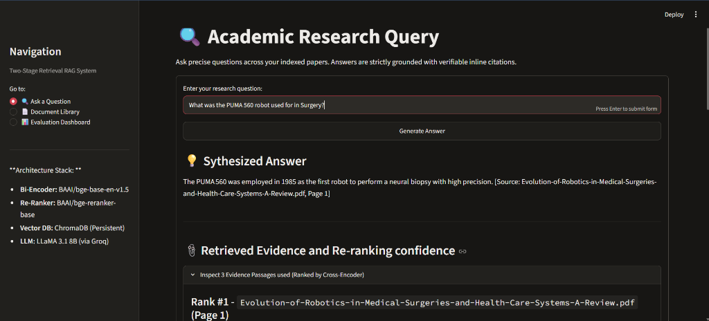
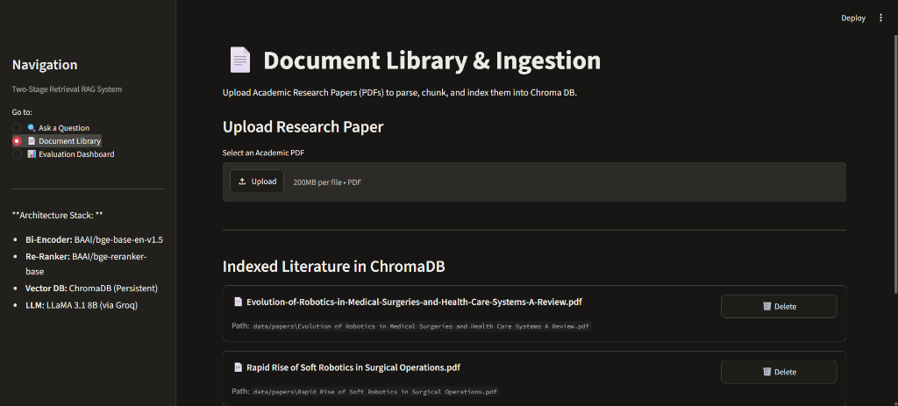
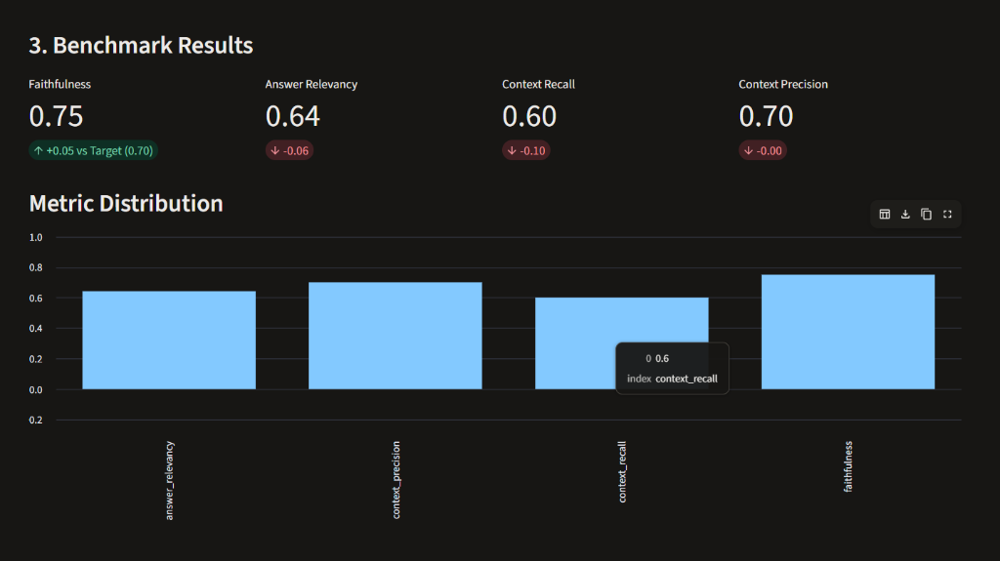
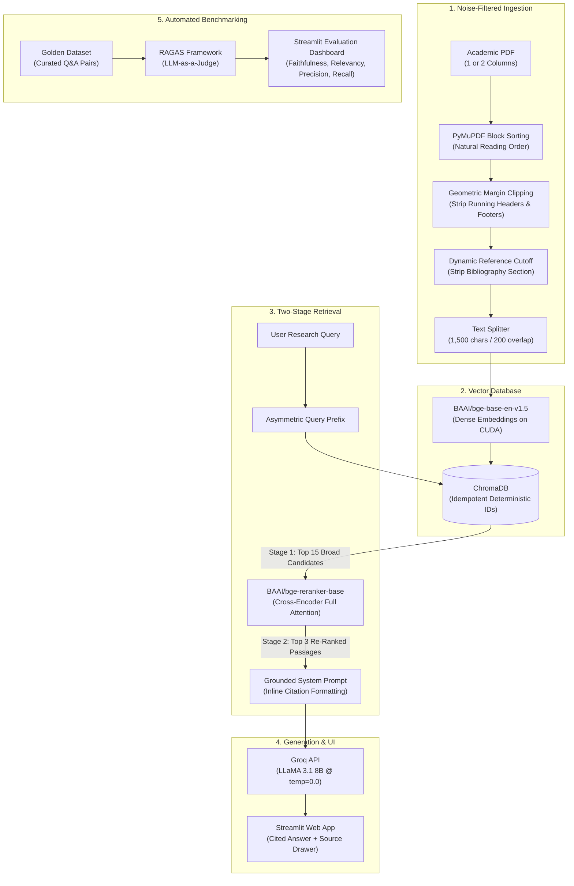

# 📚 Academic Literature AI Assistant (RAG)

> **A high-precision, two-stage Retrieval-Augmented Generation (RAG) system engineered to parse, index, and query dense, multi-column scientific papers with verifiable inline citations and quantitative evaluation.**

[](https://python.org)
[](https://streamlit.io)
[](https://www.langchain.com/)
[](https://www.trychroma.com/)
[](https://huggingface.co/BAAI/bge-base-en-v1.5)
[](https://groq.com)
[](https://ragas.io)

---

## 📸 Application Showcase

### 1. Research Query Interface & Source Inspection
*Natural language querying with deterministic inline citations and an expandable evidence drawer showing Cross-Encoder relevance rankings.*

<p align="center">
  
</p>

### 2. Document Library & Ingestion Manager
*Upload, manage, and inspect indexed research papers with automatic two-column parsing, noise elimination, and persistent storage.*

<p align="center">
  
</p>

### 3. Automated RAGAS Evaluation Dashboard
*Built-in quantitative assessment benchmarking Faithfulness, Relevancy, Precision, and Recall against a ground-truth dataset.*

<p align="center">
  
</p>

---

## 🌟 Why Naive RAG Fails on Academic Papers

Standard RAG implementations typically fail when querying research literature due to three domain-specific hurdles:
1. **Multi-Column Layout Disruption:** Academic papers are printed in two columns. Standard PDF extractors read across horizontal scanlines, interleaving columns into nonsensical sentences.
2. **Bibliography & Header Poisoning:** Academic papers dedicate 15–25% of their length to reference lists. Because citations are packed with concentrated keywords, naive vector search often retrieves references instead of actual research findings.
3. **The Proper-Noun Dilution Trap:** Bi-encoder dense embeddings compress entire chunks into static vectors, diluting specific technology names (e.g., `PUMA 560`, `NeuroArm`, `LINAC`) in broad conceptual themes.

### How This Project Solves Them:
* **Spatial Coordinate Sorting:** Uses PyMuPDF's block sorting to detect multi-column gutters, reading Column 1 fully before Column 2.
* **Geometric Margin Clipping & Dynamic Cutoff:** Strips running headers/footers based on bounding-box coordinates and halts ingestion upon reaching the `REFERENCES` heading.
* **Two-Stage Retrieval (Bi-Encoder + Cross-Encoder):** Uses ChromaDB to cast a wide net (Top 15 candidates), then applies a **Cross-Encoder re-ranker** (`BAAI/bge-reranker-base`) with full token-level self-attention to prioritize specific named entities at Rank #1.

---

## 🏗️ System Architecture



---

## 📈 Scale & Workload Capacity

The system is optimized for personal and lab-scale research libraries running entirely on local consumer hardware:

| Parameter | Specification | Description |
| :--- | :--- | :--- |
| **Document Library Capacity** | **10 to 50+ papers** | Ideal for a targeted literature review or thesis research library. |
| **Document Page Length** | **10 to 30+ pages/paper** | Tested on dense review articles; supports papers up to 100+ pages. |
| **Max Upload File Size** | **Up to 200 MB per PDF** | Configured via Streamlit's file uploader. |
| **Chunk Window & Density** | **1,500 chars (~250–300 words)** | 200-character overlap prevents boundary context loss. |
| **Vector Storage Scalability** | **Tens of thousands of chunks** | ChromaDB with persistent HNSW indexing provides sub-50ms vector search. |
| **Retrieval Throughput** | **Sub-second search** | Stage 1 vector search (~20ms) + Stage 2 re-ranking (~100ms on GPU). |

---

## 💻 Compute & Hardware Requirements

The pipeline is designed to run efficiently on accessible, consumer-grade hardware:

| Component | Execution Target | Memory / Compute Footprint |
| :--- | :---: | :--- |
| **Bi-Encoder Embedding Model** (`bge-base-en-v1.5`) | GPU (CUDA) or CPU | **~1.0 GB VRAM** (FP32) |
| **Cross-Encoder Re-Ranker** (`bge-reranker-base`) | GPU (CUDA) or CPU | **~1.1 GB VRAM** (FP32) |
| **Total Dedicated GPU VRAM** | NVIDIA GPU | **~2.1 GB VRAM** (Easily fits within a **GTX 1650 4GB** or any GPU $\ge$ 3GB) |
| **CPU Fallback Mode** | CPU | Automatically supported via `device="cpu"` in `config.py` |
| **System RAM** | Host Memory | **8 GB minimum** (16 GB recommended) |
| **LLM Inference** (`LLaMA 3.1 8B`) | Cloud (Groq API) | **0 GB local VRAM** (~500 tokens/sec via Groq LPU inference) |

---

## 📊 Empirical Benchmark Results (RAGAS)

Quantitative evaluation was performed across a curated benchmark dataset of academic research questions using the **RAGAS framework** (LLM-as-a-Judge):

| Metric | Target | **Empirical Score** | Description |
| :--- | :---: | :---: | :--- |
| **Faithfulness** | `0.70` | **`0.75`** *(+0.05)* | **Hallucination Resistance:** 75% of all generated claims are directly verifiable in the retrieved context. |
| **Context Precision** | `0.70` | **`0.70`** | **Re-ranking Efficiency:** High signal-to-noise ratio; the Cross-Encoder consistently places relevant chunks at Rank #1. |
| **Answer Relevancy** | `0.70` | **`0.64`** | **Directness:** Measures how directly the response addresses the prompt without extraneous conversational filler. |
| **Context Recall** | `0.70` | **`0.60`** | **Retrieval Coverage:** Proportion of ground-truth reference facts successfully captured in the top chunks. |

---

## 📂 Project Directory Structure

```text
academic-rag/
├── app.py                     # Streamlit application entry point & router
├── config.py                  # Centralized configuration & hyperparameters
├── requirements.txt           # Production dependencies with pinned compatibility
├── assets/                    # UI screenshots for documentation
│   ├── query_demo.png
│   ├── document_library.png
│   └── eval_dashboard.png
├── core/                      # Pure Python RAG Engine (Zero UI dependencies)
│   ├── ingestion.py           # Layout-aware extraction, margin clipping & chunking
│   ├── embeddings.py          # BGE-base embedding model (cached singleton)
│   ├── vector_store.py        # ChromaDB client with deterministic chunk IDs
│   ├── reranker.py            # BGE Cross-Encoder re-ranking engine
│   ├── retriever.py           # Two-stage retrieval orchestrator
│   └── generator.py           # Citation-enforcing prompt & Groq LLaMA 3.1 synthesis
├── ui/                        # Modular Streamlit Presentation Layer
│   ├── query_page.py          # Interactive research query interface & citation drawer
│   ├── upload_page.py         # PDF upload, live parsing & document library manager
│   └── eval_page.py           # RAGAS metrics dashboard, charts & diagnostics
├── evaluation/                # Quantitative Benchmarking Suite
│   ├── evaluator.py           # RAGAS test runner with concurrency & batch throttling
│   ├── golden_dataset.csv     # Curated benchmark Q&A pairs
│   └── results/               # Persistent CSV logs of all evaluation runs
└── data/                      # Local runtime data (Gitignored)
    ├── papers/                # Raw uploaded PDF documents
    └── chroma_db/             # Persistent ChromaDB vector index
```

---

## 🛠️ Technology Stack & Architectural Decisions

| Layer | Technology | Architectural Rationale |
| :--- | :--- | :--- |
| **Language** | Python 3.11+ | Clean typing, comprehensive NLP/ML library ecosystem. |
| **UI Framework** | Streamlit | Rapid, component-driven UI with reactive state management. |
| **PDF Extraction** | PyMuPDF (`fitz`) | 10× faster than PyPDF; provides spatial coordinates for block sorting and margin clipping. |
| **Vector Store** | ChromaDB (Persistent) | Local-first, disk-backed vector storage with deterministic ID idempotency. |
| **Bi-Encoder** | `BAAI/bge-base-en-v1.5` | SOTA performance on MTEB retrieval benchmark; 768-dim dense representations. |
| **Cross-Encoder** | `BAAI/bge-reranker-base` | Performs joint token cross-attention across query and passage to prevent entity dilution. |
| **LLM Provider** | Groq (`llama-3.1-8b-instant`) | Ultra-fast inference (~500 tokens/sec) and generous free tier (14,400 RPD). |
| **Evaluation** | RAGAS & Pandas | Industry-standard quantitative evaluation measuring the complete RAG triad. |

---

## ⚡ Quick Start Guide

### 1. Clone & Set Up Environment
```bash
git clone https://github.com/your-username/academic-literature-rag.git
cd academic-literature-rag

python -m venv venv

# Windows (PowerShell):
.\venv\Scripts\Activate.ps1
# Linux / macOS:
source venv/bin/activate

pip install -r requirements.txt
```

### 2. Configure Environment Variables
Create a `.env` file in the project root:
```bash
GROQ_API_KEY=your_groq_api_key_here
```
*(Get a free key from [console.groq.com](https://console.groq.com))*

### 3. Launch the Application
```bash
streamlit run app.py
```
Open [http://localhost:8501](http://localhost:8501) in your browser.

---

## 📜 License

Distributed under the MIT License. See `LICENSE` for more information.
